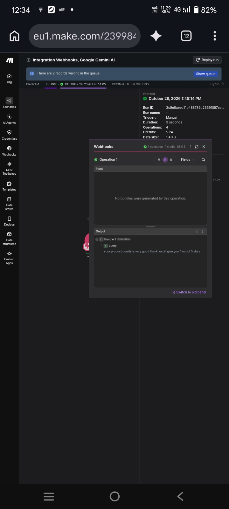
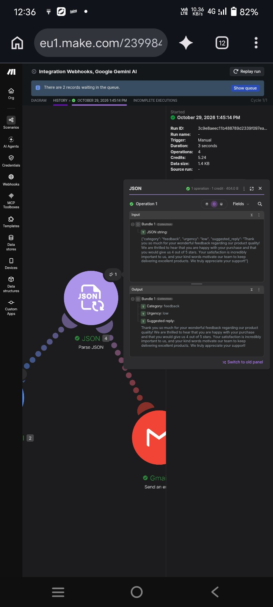
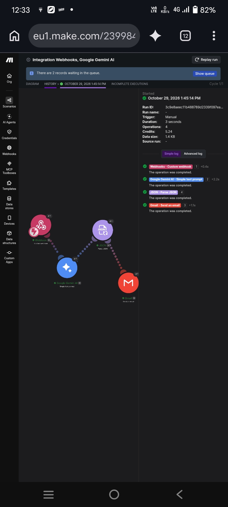
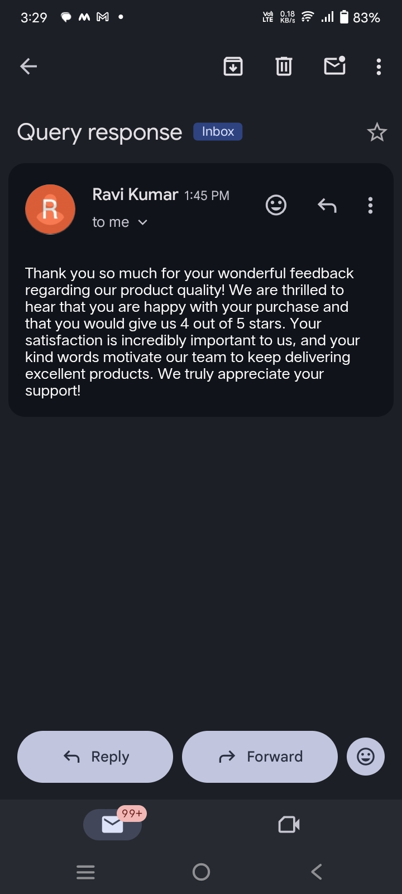

# ai-customer-query-responder
An AI-powered automation that analyzes incoming customer queries, classifies category and urgency, and sends an automatic personalized email reply — built with Make.com and Google Gemini AI.
## What it does
This automation listens for incoming customer queries, uses AI to analyze them, and sends back an instant, personalized email reply — no manual work needed.

## How it works
1. **Webhook** receives the customer query
2. **Google Gemini AI** analyzes the query and generates:
   - Category (complaint / question / feedback)
   - Urgency (low / medium / high)
   - A suggested professional reply
3. **Gmail** sends the AI-generated reply automatically

## Tools used
- Make.com (automation platform)
- Google Gemini AI (language model)
- Webhooks
- Gmail integration

## Real-world use case
Businesses can use this to instantly respond to customer support queries, reducing response time and ensuring no query goes unanswered.

## Demo

**1. Customer query received (input)**

**2. AI analysis: category, urgency and suggested reply**

**3. Successful end-to-end run**

**4. Final email received by the customer**

